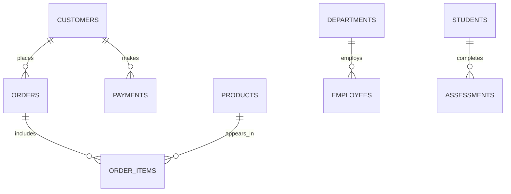

# ITS Chapter 8: SQL practice database

This is a **teaching fixture**, not production data. Run [the Oracle SQL setup file](./ch08-practice-database.sql) in a clean schema to create and seed the tables used for general SQL-writing exercises.

**Important precedence rule:** A question that explicitly includes its own values/tables uses **that question's fixture**, even when it differs from this shared database. This keeps existing answer memorandums valid.

## Table inventory

| Table | Primary key | Relevant columns |
|---|---|---|
| CUSTOMERS | customer_id | name, city |
| ARCHIVE_CUSTOMERS | customer_id | archived customer IDs |
| ORDERS | order_id | customer_id, status, total, order_date |
| PRODUCTS | product_id | name, category, price |
| ORDER_ITEMS | (order_id, product_id) | qty, unit_price |
| DEPARTMENTS | dept_id | dept_name |
| EMPLOYEES | emp_id | name, dept_id, salary |
| PROMOTIONS | promotion_id | name |
| PAYMENTS | payment_id | customer_id, paid_at, paid_amount |
| ORDER_LOG | none (example audit table) | order_id, changed_at |
| PRICE_AUDIT | none (example audit table) | product_id, old_price, new_price, changed_at |
| STUDENTS | student_id | name |
| ASSESSMENTS | assessment_id | student_id, course_id, mark, assessed_at |
| VISITS | none (practice log) | patient_id, visit_date |
| INVOICES | invoice_id | status, amount |

## Relationships



## Customers

| customer_id | name | city |
|---:|---|---|
| 1 | Asha | Cape Town |
| 2 | Bongani | Durban |
| 3 | Chipo | Cape Town |
| 4 | Dineo | Johannesburg |

## Orders

| order_id | customer_id | status | total | order_date |
|---:|---:|---|---:|---|
| 101 | 1 | PAID | 200 | 2026-11-01 |
| 102 | 1 | PAID | 300 | 2026-11-03 |
| 103 | 2 | PENDING | 100 | 2026-11-05 |
| 104 | 3 | PAID | 1800 | 2026-10-15 |
| 105 | 3 | PAID | 750 | 2026-11-09 |

## Employees

| emp_id | name | dept_id | salary |
|---:|---|---:|---:|
| 1 | Eli | 3 | 35000 |
| 2 | Faye | 3 | 45000 |
| 3 | Gugu | 7 | 20000 |
| 4 | Hani | 7 | 30000 |

## Typical queries

**Customers without orders:**

```sql
SELECT c.customer_id, c.name
FROM CUSTOMERS c
LEFT JOIN ORDERS o ON o.customer_id = c.customer_id
WHERE o.order_id IS NULL;
```

**Revenue per customer including zero-order customers:**

```sql
SELECT c.name, COUNT(o.order_id) AS paid_orders,
       NVL(SUM(o.total), 0) AS paid_revenue
FROM CUSTOMERS c
LEFT JOIN ORDERS o
  ON o.customer_id = c.customer_id AND o.status = 'PAID'
GROUP BY c.customer_id, c.name;
```

When writing your own SQL, use the shared schema. When tracing a printed query result, use the tables shown within that specific question.
